<p align="center">
  
</p>

# pixel-profile

Animated **pixel-art** SVGs for your GitHub profile README: a night-city banner with a floating, blinking ghost, a game-style status card, a pixel divider and a "PRESS START" footer.

- **One Python file, zero dependencies.** Standard library only, Python 3.8+.
- **Every pixel is drawn.** The 5×7 font and sprites are plain rectangles, so there are no web fonts to load (GitHub's image proxy blocks them anyway).
- **Animated without JavaScript.** SMIL animations play on GitHub, in dark and light mode, in any modern browser.
- **Auto-fit.** Long names and taglines scale down, and chips that don't fit are dropped instead of overflowing.

<p align="center">
  
</p>

## Quick start

1. Create your profile repository (a public repo named exactly like your username) if you don't have one.
2. Copy `pixel_profile.py` into it and generate the images:

   ```bash
   python pixel_profile.py --title "YOUR NAME" --handle your-username --stack TS,GO,RUST --out assets
   ```

3. Add them to your `README.md`:

   ```html
   <p align="center"></p>
   <p align="center"></p>
   <p align="center"></p>
   <p align="center"></p>
   ```

4. Commit and push.

## Full config

For everything else, copy [`profile.example.json`](profile.example.json), edit it, and pass it with `--config`:

```bash
python pixel_profile.py --config profile.json --out assets
```

| Key | What it is |
|---|---|
| `title` | Big banner text |
| `handle` | Shown as `> handle` under the title, with a blinking cursor |
| `tagline` | Second banner line |
| `card_title` | Status card window title (default `STATUS.EXE`) |
| `player` | Name plate under the ghost on the card |
| `fields` | Up to 3 `[label, value]` rows on the card |
| `stack` | Chips on the card (as many as fit) |
| `status` | Text next to the blinking status light |
| `quest` | The QUEST row |
| `footer` / `footer_hint` | Footer message (`*` draws a heart) and the blinking line under it |

`--title`, `--handle`, `--tagline` and `--stack` on the command line override the config file.

The font covers `A–Z`, `0–9` and ``> _ . : / - ! ? * & ( ) [ ] < + = , ' # @ $ % | ~ ·``. Text is uppercased, and anything else is drawn as `?`.

## Examples

The images in [`examples/`](examples) are generated from `profile.example.json`, the same setup as [my profile](https://github.com/sknoyon324234234234).

<p align="center"></p>

## License

MIT
